# w3cos 下一代 AI Shell 体验设计

这是壳的体验规格，不是实现。当前分支上的 shell 代码不动。拖拽、缩放、最大化、分屏落点和按设备恢复窗口几何，由合成器负责；本文第 12 节是给它的外观和命中契约。

默认语言是简体中文。英文是另一套文案，不是每一行后面再写一遍。

稿面在 `mockups/`，由其中的 HTML 渲染成 `screenshots/` 的 PNG。看图之前先看第 2 节的审计，那些问题决定了后面的布局。

## 1. 这个壳是什么

w3cos 的壳是意图优先、本机优先的系统界面。人说出要做的事，壳给出一张可以核对的提议，确认之后才执行，然后写下一张收据。身份是本机的 `did:key`，不是账号，也不依赖公链。

意图分三层，层和层的差别必须能在界面上读出来：

| 层 | 何时 | 默认 | 界面上怎么说 |
| --- | --- | --- | --- |
| L0 | 这句话能对上规则表 | 开 | L0 规则 |
| L1 | 规则表没有，本机同义词对上了 | 开，`W3COS_L1=0` 可关 | L1 同义 |
| L2 | 多步，或前两层都没有对上 | **关**。要设 `W3COS_L2=1` 并本机起推理进程 | L2 规划。没开时不出现这枚标记 |

L2 关掉的时候，多步句子不会偷偷执行第一句。见第 7.1 节。

同一套规则覆盖桌面、平板和手机。多台设备可以接续任务，接续是配对之后的加密同步。确认不会跟着设备走。

## 2. 现状审计

看过两份材料，它们不是同一个界面。

1. 仓库公开图 `docs/screenshot.png`。README 仍用它当产品面貌。
2. 本分支 `crates/w3cos-shell/src/main.rs` 里正在跑的壳：上下文条、意图条、任务中心、任务栏、文件、终端、设置、浏览器、编辑器、锁屏状态和收据。

公开图是居中的英文图标、四张假指标、底部「W3C Apps」。没有意图、没有确认、没有收据。当前壳已经有这些，但公开图没有跟上，所以外面看到的和里面做的对不上。

下面的问题都指当前壳，除非注明是公开图。

1. **任务中心默认占掉右侧 340px。** `TASKS_SIGNAL` 初始值是 1。桌面一进来就是代理面板：主体、锁定、步骤、收据原文堆在一起。桌面不是桌面。
2. **中英双写。** 「提议 Propose」「确认后才会执行 · Confirm to run」「已锁定。确认前请先解锁。Locked — unlock before confirm.」每一句读两遍。中文行高被拉丁词撑开，按钮宽度不可预期。
3. **意图条是永远展开的第二排工具栏。** 上下文条、输入框、六枚双语芯片在每个应用上方常驻。芯片把「打开文件」这种导航做成和「提议」同级的按钮，输入框反而像附属品。
4. **图标是字母。** 桌面和任务栏用 F / T / S / A，颜色是主要辨识。任务栏只有这四个，桌面还有浏览器和编辑器。当前应用没有选中态。公开图是同一套字母方块。
5. **窗口按钮是假的。** 标题栏的 `--`、`[]`、`X` 没有点击行为。应用整页换掉桌面，不是窗口。最小化、最大化和关闭都是装饰。公开图同样如此。
6. **确认和授权是同一个视觉重量。** 确认卡嵌在意图条里，和芯片一样是一块深色条。打开文件，和放行 `w3cos-process`，没有分成两次决定。
7. **锁定不是锁屏。** 顶栏一颗灰胶囊写「已锁定 / 已解锁」。解锁按钮在任务中心里，文案承认是 stub（`stub-passkey`）。没有钥匙交互，锁定也不挡住桌面。
8. **上下文按钮像关闭窗口。** 「Desktop ×」用乘号表示「停止把当前应用告诉代理」。乘号的习惯含义是关掉这个东西。
9. **设置侧栏点不了。** 「身份」「桥接」只是文字。夜间模式只显示「开 / 关」，那一行不能切换。主体是一整条 `did:key`。注册说明是实现备注：「WebAuthn 仪式还没做」。
10. **假数据被当成现状。** 桌面 CPU 23%、内存 5.4 / 8 GB、存储、网络是写死的，进度条一律约 40%。任务栏时钟固定 14:32，电量 92%，状态是 Online。文件列表、浏览器、编辑器是静态英文样例，侧栏不能切换。公开图是同一类假指标。
11. **终端文案和能力互相矛盾。** 页面写「命令还不会执行」，运行按钮又会走 `w3cos-process`，而且只允许 echo、pwd、help。
12. **收据是最多八行原文。** 空的时候一句「还没有收据。No receipts yet.」没有按时间、决定、层级分组，也看不到操作编号。允许、拒绝、取消、未识别长得一样。
13. **层级靠颜色，而且 L0 没有标记。** L1 是橙底，L2 是蓝底。L2 默认关闭这件事，要打开任务中心才看见「本地 L0/L1 · 无模型」。规划中的句子是「模型在后台线程」。
14. **没有通知。** 运行时有通知接口，壳里没有通知中心。结果只出现在「结果 Result」条或任务中心。
15. **「助手」窗口是空的。** 它告诉人去看右边的任务中心，和任务中心重复。
16. **触控和焦点不够。** 按钮大约 13px 字加 8px 内边距，低于 44px。组件样式里没有可见焦点环。确认卡不是对话框，焦点不会被圈住。状态主要靠颜色。中文没有字体栈，双语字符串的换行不稳定。
17. **没有第二种尺寸。** 壳是单列 `100vw`。没有底栏意图、没有应用切换、没有手势，平板和手机无法用同一套信息架构。
18. **没有设备接续。** 身份、收据、剪贴板都停在本机。不存在配对、信任、加密同步，也不存在「在另一台继续」。确认本来就不该在另一台自动生效，但界面上没有地方把这件事说出来。

## 3. 原则

1. **意图在前。** 桌面上最稳的控件是一句话输入。导航、芯片、指标不能跟它抢。
2. **四步不合并。** 提议、确认、执行、收据。没确认就不执行。取消和拒绝也写收据。
3. **授权是另一次决定。** 打开一个应用，和放行进程、采集画面、把剪贴板交给另一台设备，不是同一张卡。
4. **一种语言。** 界面跟系统语言。规格稿用简体中文。不把英文对照焊在控件上。
5. **层级说人话。** 标记写「规则 / 同义 / 规划」，后面才是 L0 / L1 / L2。L2 没开就不要出现规划中的空转。
6. **本机优先。** 钥匙、收据、推理都不经过账号服务器。界面不出现「登录」。
7. **一套系统，三种姿势。** 桌面用窗口和任务栏，平板用栏和分栏，手机用栈、底栏和手势。文案、收据、确认、颜色是同一套。
8. **接续不继承确认。** 路径、草稿、已写下的收据可以过去。没确认的动作到了另一台，仍要那台设备上的人确认。解锁也不跨设备。
9. **壳管含义，合成器管几何。** 窗口长什么样、最小尺寸、落点提示，写在这里。指针怎么拖，不在这里实现。

## 4. 信息架构

```text
壳
├── 桌面或主屏
├── 意图
│   ├── 输入
│   ├── 确认卡（导航、主题、一步动作）
│   ├── 规划中（仅 L2 打开之后）
│   └── 未识别
├── 权限单（进程、画面采集、跨设备的某一面）
├── 窗口（桌面）/ 分栏（平板）/ 栈（手机）
│   ├── 文件
│   ├── 终端
│   ├── 浏览器
│   ├── 编辑器
│   └── 设置
├── 任务栏或底栏
│   ├── 启动器
│   ├── 正在运行
│   └── 托盘：锁、设备、通知、L2 状态、时钟
├── 通知
├── 收据
├── 锁屏
└── 设置
    ├── 本机
    ├── 身份
    ├── 代理能力
    └── 设备与接续
```

代理不是一个应用。现在的「助手」窗口删掉。收据、规划和步骤从托盘进，不占默认桌面。

应用只有五个常驻图标：文件、终端、设置、浏览器、编辑器。收据和设备从托盘或启动器进，不铺在桌面上。

上下文共享改名，并且搬进设置里的「代理能力」，不再放在顶栏。它的意思是：允许本机代理看见当前窗口的结构。它和跨设备同步是两件事。控件用开关，不用乘号。

## 5. 自适应

断点按宽度和指针一起判，不按设备型号。

| 宽度 | 指针 | 姿势 |
| --- | --- | --- |
| < 600px | 粗 | 手机。单窗栈。意图在底部。上滑是切换器，下滑是通知。 |
| 600–1023px | 任意 | 窄平板。左侧 72px 图标栏，内容单栏，意图在底部。 |
| ≥ 1024px | 细 | 桌面。自由窗口，悬浮任务栏，意图条在任务栏上方。 |
| ≥ 1024px | 粗 | 宽平板。左栏加分栏。不用自由窗口，避免用手指拖标题栏。 |

粗指针的点击目标至少 48×48px。细指针的任务栏图标可以是 40×40px，因为启动器和键盘能到达同一批动作。

安全区：手机底部意图条留在系统手势条之上，规格稿按 28px。平板横握时意图条宽 520px，居中，不拉成整条。

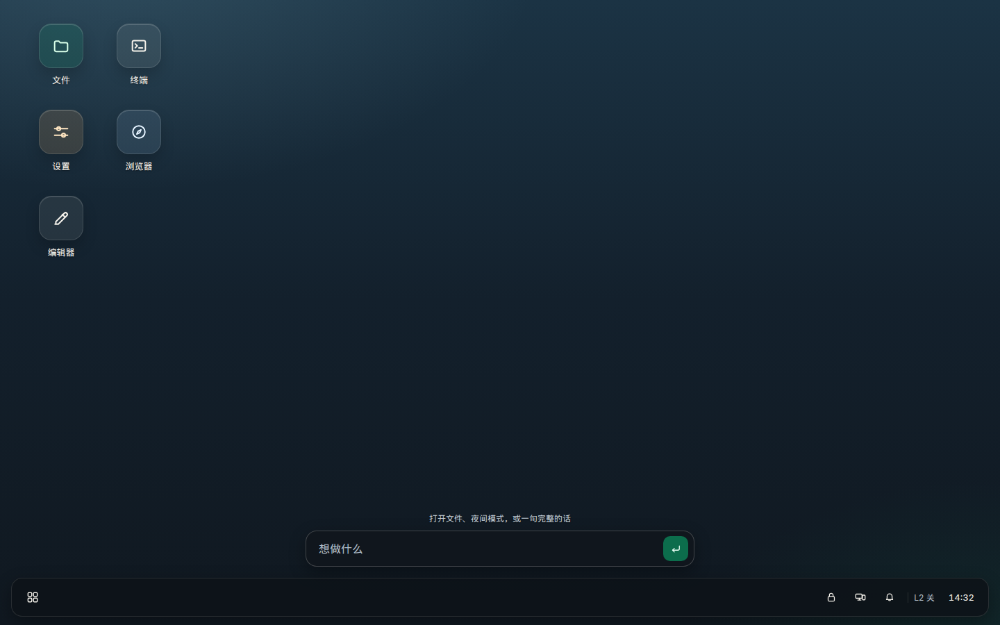

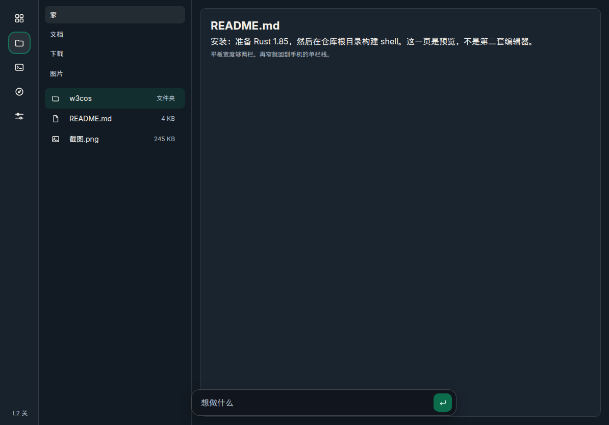

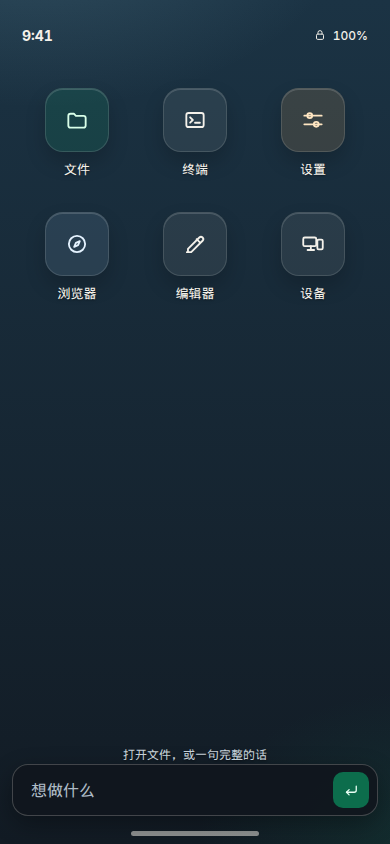

### 5.1 桌面

壁纸上只有左侧图标，两列。不放 CPU、内存、品牌水印。那些数字以前是假的，真的系统状态进设置，不进桌面。

意图条宽 560px，浮在任务栏上方，水平居中。空闲时只有输入框和提交。输入框下面不放一排常驻芯片。框为空时，上方可以有一行说明：「打开文件、夜间模式，或一句完整的话」。这行不是按钮。

任务栏左右留 16px，圆角，浮在壁纸上。从左到右：启动器、正在运行的应用、弹性空白、锁、设备、通知、`L2 关` 或 `L2 开`、时钟。正在运行的应用下面有一条短标记，颜色不是唯一手段，读屏名称里带「正在使用」。

### 5.2 平板

左栏是启动器的常驻形态，当前应用用描边标出，不靠颜色单独表示。宽平板的文件是两栏：列表和预览。再窄就回到单栏，和手机同一套栈。意图条仍在底部中央。窗口几何不在平板上自由漂浮。

### 5.3 手机

主屏就是启动器。没有桌面任务栏。底部是意图条，拇指够得到。

- 从底边上滑：应用切换器。卡片可以上滑关闭。
- 从顶下滑：通知。
- 边缘返回：关掉最上面的一层。权限单和确认卡不能用边缘返回关掉，必须点拒绝、取消或确认。
- 长按图标：固定或查看简介，不直接执行带副作用的动作。

切换器里的卡片是这台手机上的窗口栈，不携带另一台设备的坐标。

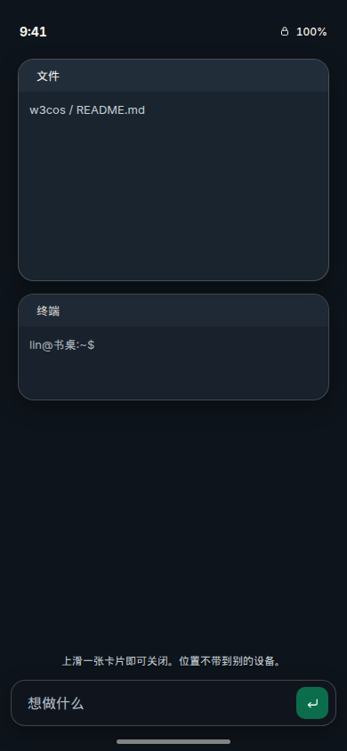

## 6. 意图条

占位：「想做什么」。

提交在细指针上是回车图标，名称为「提议」。回车键等同于点它。手机上目标保持 48px 高，点按区域包住图标。

键盘：

| 键 | 作用 |
| --- | --- |
| 聚焦意图的快捷键 | 桌面用 Ctrl+K 或 ⌘K。手机没有这条。 |
| Enter | 框里有字且没有打开的卡：提议。确认卡上的「确认」获得焦点时：确认。 |
| Esc | 关掉最上面一层：权限单，然后确认卡，然后通知或启动器。不锁屏，不关窗口。 |

提议之后输入框保留原句，方便改。改一个字会取消尚未执行的提议，并写一张取消收据，避免旧卡和新句子对不上。

L0 的例子沿用现有命令：打开文件、打开终端、打开设置、打开编辑器、打开浏览器、夜间模式、应用列表、我在哪、帮助。中文和英文命令都进规则表，但界面只显示当前语言的摘要。

## 7. 关键流程

### 7.1 提议和确认

```text
输入
  ├─ 对上规则表 ─────────────► 确认卡 · L0 规则
  ├─ 同义词对上 ─────────────► 确认卡 · L1 同义
  ├─ 多步或都没对上，且 L2 开 ► 规划中 · 还没有执行
  └─ 多步或都没对上，且 L2 关 ► 未识别 · 不执行第一句
确认
  ├─ 只是导航或主题 ─────────► 执行 ► 收据 ► 通知
  └─ 还要额外能力 ───────────► 权限单 ► 执行或拒绝 ► 收据
```

确认卡是对话框，不是任务栏里的一条状态。

- 标记在标题上面，文字写全，不单靠颜色。
- 标题是动作，不是「请确认」。例：「打开文件」。
- 下一行是影响。例：「切换到文件窗口。不读取、不修改磁盘上的内容。」
- 主按钮「确认」，次按钮「取消」。取消在左，确认在右。
- 脚注：「确认后才会执行，并写下一张收据。」
- 纯导航：焦点进「确认」。会改状态或需要能力的：焦点进「取消」或「拒绝」。

手机上同一张卡变成底部抽屉，按钮高 48px，各占一半。

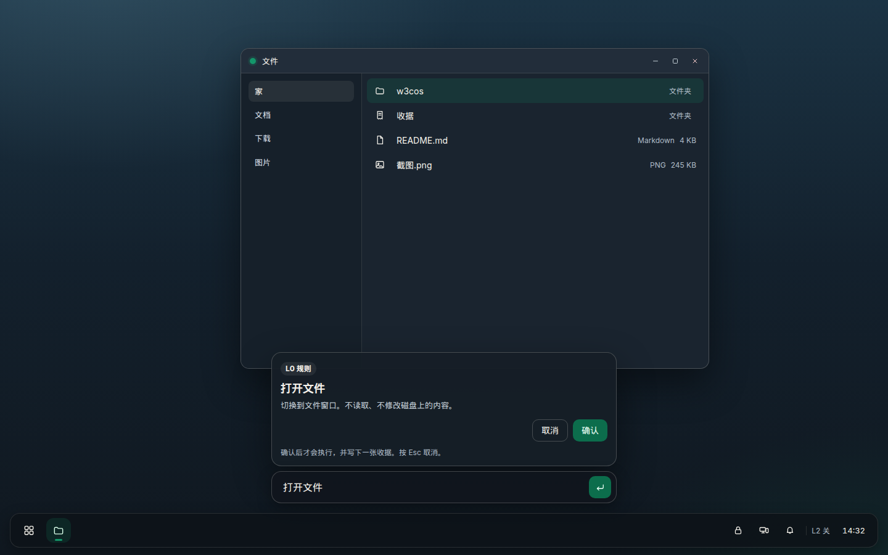

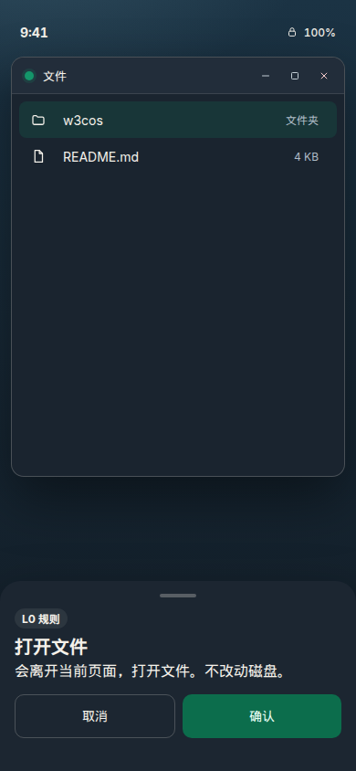

L1 的卡多一句：「这句话没有对上规则表，本机把它当成同一件事。」琥珀色标记写「L1 同义」。仍然要确认，不能因为像就直接执行。

L2 打开而且句子是多步时，不先跑第一句。规划在界面上是「正在本机规划。还没有执行。」可以停止。停止写取消收据。规划完之后，每一个会改东西的步骤各有一张确认卡。只读步骤不打断，但出现在步骤列表里。

L2 关着，句子里有「然后、并且、and、then」这类连接，或两层都没对上：

> 这句话有两步，或者没有对应的动作。本地规划关着，所以不会先做第一件。可以拆开说，或在设置里打开 L2。

然后写一张未识别收据。

### 7.2 权限

权限单是遮罩上的另一张对话框，标题和确认卡不同，避免人觉得系统把同一个问题问了两遍。

| 能力 | 何时问 | 可以给多久 |
| --- | --- | --- |
| 无障碍读取 | 交互会话启动时已经给了本机壳 | 本次会话。设置里可见，不在每个动作上再问 |
| 代理操作 `w3cos-agent-act` | 包在那一次确认里 | 这一次调用，然后收回 |
| 画面采集 | 真的要像素时 | 仅此一次，或本次会话。不提供始终 |
| 进程 `w3cos-process` | 终端要跑 echo、pwd、help | **仅此一次**。不提供本次会话，不提供始终。跑完收回 |

进程单的文案：

- 标题：「允许运行这一次 echo」
- 说明：「这不是刚才那个确认。打开终端已经完成。现在要单独授权进程，用完即收回。」
- 范围：「只放行 echo、pwd、help。没有系统 shell。」
- 按钮：「拒绝」「仅此一次」
- 脚注：「拒绝也会写收据。身份必须已解锁。」

锁定时两个按钮都不可用，主文案改成「先解锁。这次不会运行。」

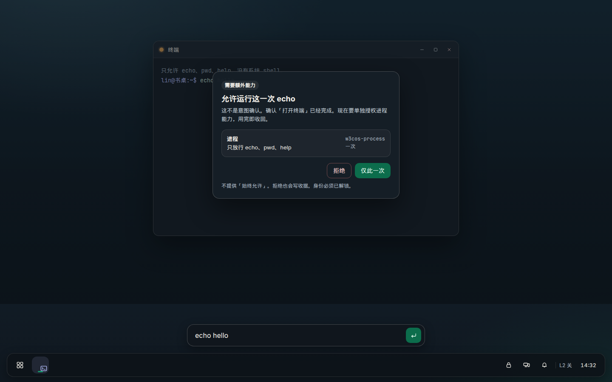

跨设备同步的每一面第一次打开时，也用这张单，不用确认卡代替。见第 8 节。

### 7.3 收据

收据从托盘进，是右侧抽屉，不是默认占满的栏。

每一行：时间、人话摘要、层级、结果、决定。决定用词，同时用颜色：

| 决定 | 词 | 含义 |
| --- | --- | --- |
| allowed | 允许 | 执行了 |
| denied | 拒绝 | 人拒绝了，或当时锁着，或能力不够 |
| cancelled | 取消 | 人停了，没有执行 |
| unrecognized | 未识别 | 没有对应动作 |

顶部是当前主体，截断显示：`did:key:z6MkhaXg…ta2doK`。点一下复制完整值。筛选：全部、允许、拒绝、取消。

空：「还没有收据。你确认并执行之后，每一条会出现在这里。取消和拒绝也会留下。」

账本只追加。换一把 `did:key` 不改写已经写下的行，旧行仍显示当时的主体。界面上不提供删除。

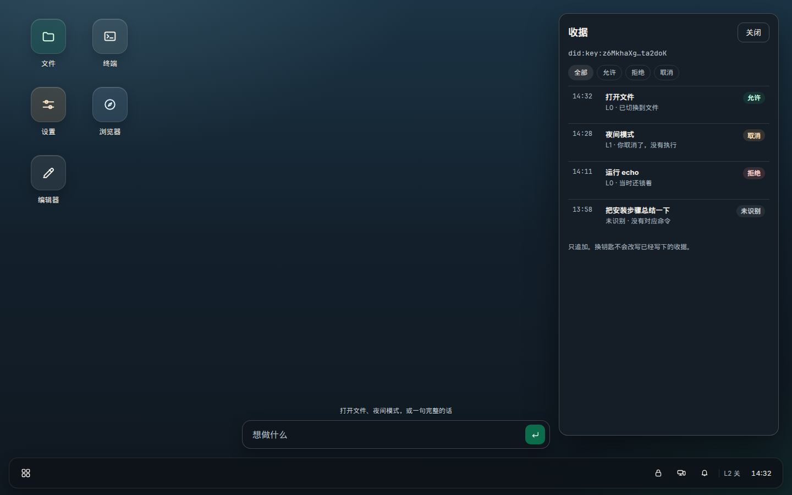

### 7.4 锁定和身份

锁定是一整屏，不是胶囊。

- 标题：「已锁定」
- 主体截断显示
- 「没有账号，也不走链。钥匙留在这台设备上。」
- 主按钮：「用本机通行证解锁」
- 脚注：「解锁只影响这台设备。」

目标交互是本机 WebAuthn / passkey。解锁成功之后，主体是由这把钥匙导出的 `did:key`。当前实现还是 PBKDF2 的占位口令，规格不把占位画成已完成的钥匙。设置里身份一栏写「通行证：尚未注册」，按钮是「注册本机通行证」。注册完成之前，锁屏按钮仍在，但设置里说清楚还没有断言验证。

已解锁后，托盘的锁变成打开的锁，名称「已解锁」。再点它就锁定。锁定立刻作废还没确认的执行，确认卡留着，但确认按钮改为「先解锁」。

提议可以在锁定时起草。确认和权限不可以。

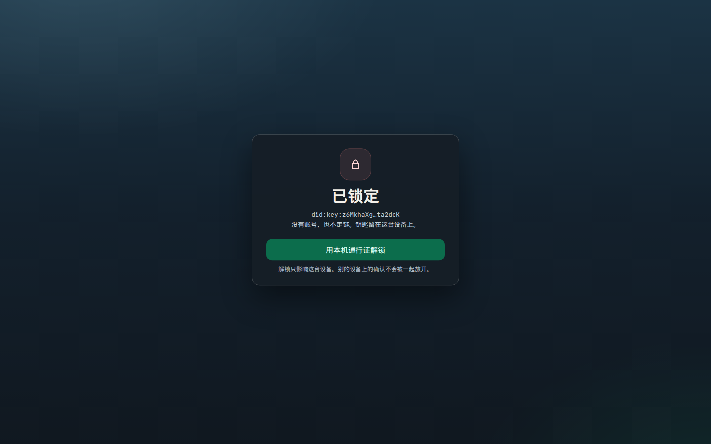

### 7.5 启动器

桌面：点任务栏的网格，左下角升起面板，后面压暗。上面是查找，然后「本机」，再是「共享运行时」。共享运行时放共享 Hello、页面、计数器这类宿主应用，不和五个系统应用混成一类。

查找没有结果：「没有叫这个的应用。」

选中一个应用：打开窗口（桌面）或压入栈（手机），然后关掉启动器。不再用整页替换桌面，也不再靠「W3C Apps」才能回来。

手机没有这块面板。主屏就是启动器。

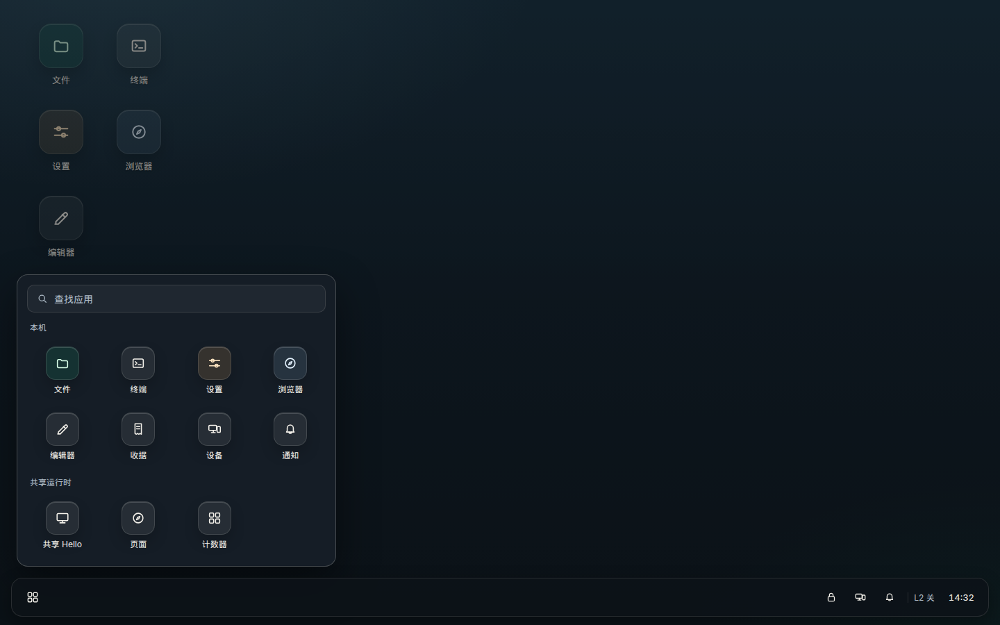

### 7.6 通知

通知报告已经发生的事，不拿来做确认。确认必须在确认卡或权限单上发生，避免人在通知里随手点一下就执行。

三条就够说明类型：

- 收据：「已打开文件。」副文「收据 #128 · L0 · 刚刚」。点进去打开收据抽屉并滚到那一行。
- 拒绝：「没有运行 echo。」副文「当时还锁着。收据已记下拒绝。」
- 设备：「手机在同一网络。」副文「尚未配对。」点进去打开设备。

桌面从托盘铃铛打开，停在右下，不盖住意图条。有未读时铃铛上有数字，数字不是唯一提示，打开后面板标题仍是「通知」。

「不打扰」只藏横幅，抽屉里还能看见。

空：「没有新通知。」

手机从顶部下拉。横幅的点击目标至少 48px 高。

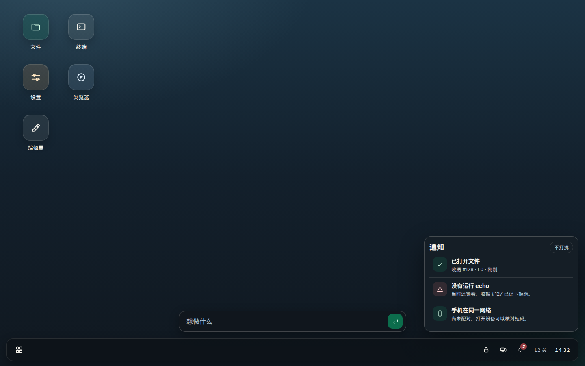

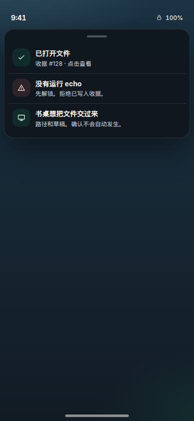

### 7.7 窗口

桌面窗口有标题栏：40px 高，左侧色点加名称，右侧最小化、最大化、关闭。按钮 28×28px，名称分别是「最小化」「最大化」「关闭」，最大化之后改为「还原」。

活动窗口在上，边框更亮。非活动窗口整体稍暗，标题仍可读。

分屏落点是一块明确的区域，文案「松开放到右半边」，不是只靠边框变色。落点、拖拽和会话恢复的行为契约在第 12 节，合成器实现。

手机没有自由窗口。切换器里是卡片栈。平板是分栏，不是缩小的桌面。

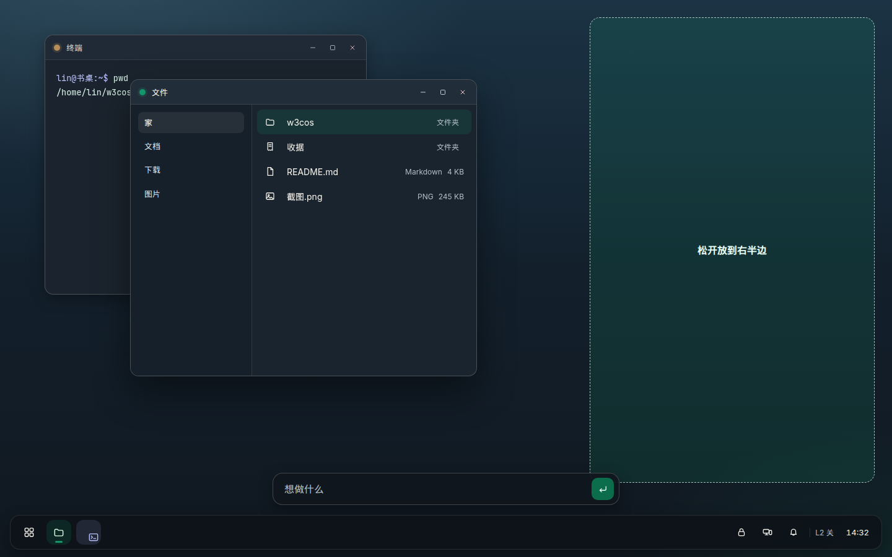

## 8. 多设备接续

接续解决的是：同一把身份下的书桌和手机，把路径、草稿和已经写下的收据接着用。它不把 w3cos 变成一个账号云。

### 8.1 不依赖中心平台

- 没有账号，没有厂商中继作为前提。发现走局域网 mDNS，服务类型 `_w3cos._udp.local`。广播里只有显示名和指纹，没有收据，没有草稿。
- 每台设备有自己的设备密钥。配对之后，本机信任库记下对方的设备密钥，并由本机身份密钥签名。
- 同步载荷用对端设备密钥密封（HPKE，X25519 与 ChaCha20-Poly1305 这一类）。不把明文交给中继。
- 跨网不在这一版承诺。不做厂商 TURN。人可以在两台面对面的设备上核对短码，这就是配对。
- 移除一台设备：停止再发给它，并轮换「场景」和「剪贴板」的内容密钥。已经写下的收据留在各台设备上，因为收据不是缓存。

### 8.2 同步哪些，不同步哪些

| 面 | 默认同步 | 结构 | 冲突 |
| --- | --- | --- | --- |
| 收据 | 开 | 只追加。幂等键是设备密钥加操作编号 | 不合并正文。两边都留 |
| 未执行草稿 | 开 | 文本用可交换序列（RGA 一类）。规格不绑定库 | 同时编辑会汇合；确认状态不在这份文档里 |
| 场景：打开的文档、路径、滚动 | 关，第一次单独问 | 集合用 OR-Set，滚动用最后写入 | 路径汇合；滚动取较新的一份并允许退回 |
| 剪贴板 | 关，第一次单独问 | 最后写入，被盖住的那份保留十分钟 | 界面列出两份，让人选 |
| 窗口坐标、分屏、最大化 | 不同步 | 每台设备自己的几何 | 不存在跨设备冲突 |
| 像素、画面采集 | 不同步 | — | — |
| 解锁 | 不同步 | 每台设备自己的通行证 | — |
| 确认本身 | 不同步 | 确认只在作出确认的那台设备上有效 | 两台同时各有一张卡，不合并成一个动作 |

「场景」和「剪贴板」默认关，是因为路径和剪贴板比收据更容易泄漏正在看的内容。收据是人已经同意留下的账。

### 8.3 配对

设置 → 设备。

1. 本机显示自己的名字和截断后的 `did:key`。名字由人改，规格稿里的「书桌」「手机」只是例子。
2. 同一局域网里出现未信任的设备，状态是「待核对」，不是「已连接」。
3. 两边都显示同一个六位短码，分成两组，例如 `481 926`。票据 90 秒失效。
4. 人核对。按钮是「数字不同」和「数字一致，信任这台」。不要只放一个确定。
5. 数字不同：不写入信任，短码作废。文案：「没有配对。」
6. 数字一致：写入信任。然后立刻问要同步哪些面，逐面用权限单，不一次默认全开。

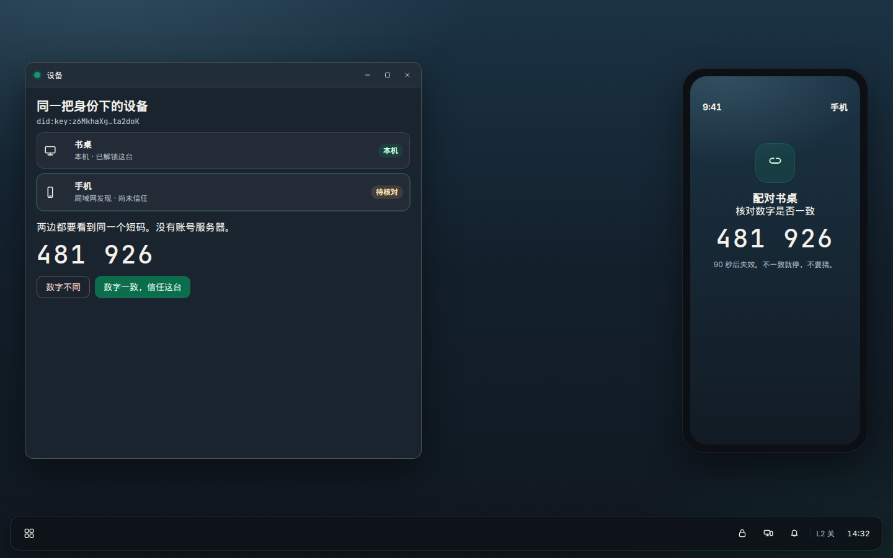

### 8.4 在另一台继续

书桌的窗口标题栏下方出现一条横幅，不是系统模态，因为人可以不理它：

- 标题：「在手机上继续」
- 说明：「加密发送当前路径和未执行的草稿。确认不会跟着过去。像素不发送。」
- 按钮：「不是现在」「继续」

点继续之后，若场景这一面还没授权，先出权限单。发送中：「正在加密发送到手机。草稿还在这台设备上。」可以取消。对方没有应答：「手机没有应答。草稿还在书桌。」

手机侧用通知，不用自动打开去执行：

- 「书桌想把文件交过来。」
- 点开之后整页是「从书桌继续」。
- 写明路径和草稿原句。
- 写明：「L2 在这台手机上仍然关闭。要做的话在这里重新提议。书桌上的确认不会自动生效。」
- 主按钮只打开文件，不提交那句草稿。

若剪贴板两面都有值，手机底部另开一张单：「剪贴板有两份。」列出设备和时间。十分钟内可以改选。这张单不挡住「打开文件」，打开文件在上面，选择在下面。

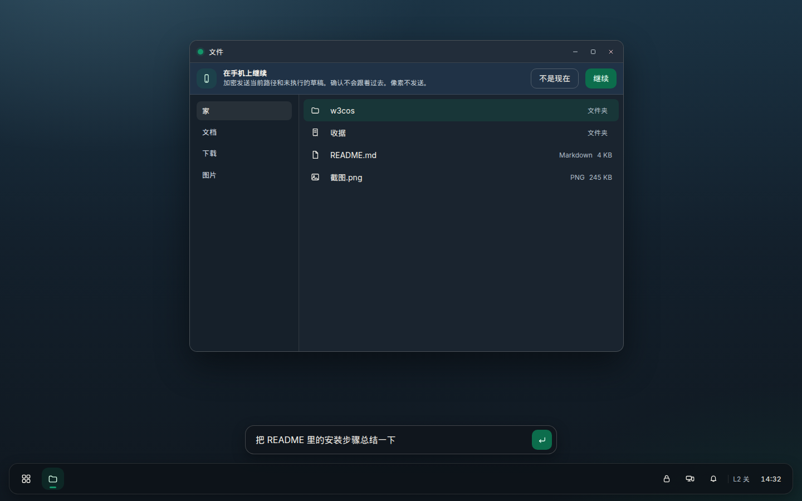

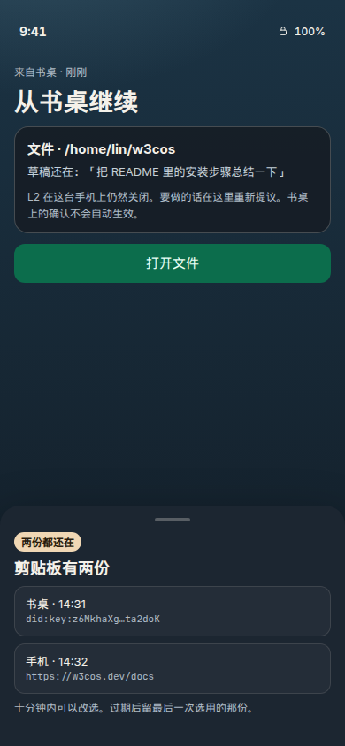

### 8.5 和「上下文共享」的边界

允许本机代理看见当前窗口，是设置里的一个开关。把它同步到另一台，仍要那台设备自己的开关。配对不会打开对方的代理权限，也不会打开对方的 L2。

## 9. 视觉

方向是墨色桌面加一种玉色。玉色只用在确认、本机、正在使用。琥珀色是待核对和 L1。珊瑚色是拒绝、锁定、破坏性动作。靛色只给 L2，而且 L2 关着的时候桌面上几乎看不见它，只在托盘写「L2 关」。

不要彩虹字母方块，不要大面积紫渐变，不要把指标做成仪表。

### 9.1 颜色

| 令牌 | 值 | 用途 |
| --- | --- | --- |
| 墨 | `#f4f1ea` | 主文字 |
| 次墨 | `#d5dee6` | 次级文字 |
| 说明 | `#c5d0d8` | 说明、占位以上的辅助句。要过 4.5:1 |
| 弱 | `#aebbc6` | 仅用于已禁用 |
| 玉 | `#0c6d4c` 底，`#e9fff5` 字 | 主按钮 |
| 琥珀 | `#f0d7b4` 底，`#2a1c0c` 字 | L1、待核对 |
| 珊瑚 | `#e07a78` | 拒绝、锁 |
| 靛 | `#2a315c` 底，`#b7c0ff` 字 | L2 |
| 线 | `rgba(244,241,234,0.12)` | 分割和描边 |
| 表面 | `#1c2631` | 卡片、窗口 |
| 坞 | `rgba(12,18,24,0.88)` | 任务栏 |

壁纸是深青到墨的渐变，左上一点冷光，右下一点玉的余光。余光不是发光按钮。

对比：主文字和说明文字在表面 `#1c2631` 上至少 4.5:1。主按钮的浅字在 `#0c6d4c` 上至少 4.5:1。焦点环用玉色 2px，偏移 2px，不靠颜色单独表示状态。

### 9.2 文字

| 用途 | 字号 | 行高 |
| --- | --- | --- |
| 说明、收据时间 | 12px | 1.5 |
| 界面正文 | 13–14px | 1.5 |
| 意图输入 | 16px | 1.5 |
| 卡片标题 | 18–20px | 1.45 |
| 锁屏标题 | 32px | 1.3 |

中文不加大字距。拉丁和中文混排时，中文决定行高，取 1.5 或 1.6，不取西文的 1.2。

字体栈：

```text
Inter, "Source Han Sans SC", "Noto Sans SC", "WenQuanYi Micro Hei", sans-serif
```

等宽，用于 `did:key`、收据编号、终端、短码：

```text
"JetBrains Mono", "Source Han Sans SC", "WenQuanYi Micro Hei Mono", monospace
```

稿面渲染环境里没有思源黑体，中文落到文泉驿微米黑。实现时优先用思源黑体或 Noto Sans SC，避免中文和 Inter 的灰度差太大。终端和短码用等宽，短码还要用表格数字，避免六位数跳动。

### 9.3 间距、圆角、图标

间距用 4 的倍数：4、8、12、16、24、32、48。

| 元件 | 圆角 |
| --- | --- |
| 按钮、输入内部控件 | 10–12px |
| 窗口、卡片、任务栏 | 14–16px |
| 手机底部抽屉 | 22px，只圆上面 |
| 桌面图标 | 18px 方圆 |

图标是 24px 网格、1.7px 圆头描边，单色 `currentColor`。不用 emoji，不用字母当图标。应用图标是同一套描边，底色只做轻微区分：文件偏玉，设置偏琥珀，浏览器偏冷灰。其余保持中性。

### 9.4 动效

| 动作 | 时长 | 曲线 |
| --- | --- | --- |
| 遮罩 | 120ms | 线性 |
| 确认卡、权限单、通知 | 180ms | cubic-bezier(0.2, 0.7, 0.2, 1) |
| 窗口打开 | 200ms | 同上 |

`prefers-reduced-motion: reduce` 时时长为 0，元素直接出现。规划中的骨架不再做闪动，改成静止的条。短码倒计时仍更新数字，但不做脉冲。

## 10. 状态

每种空、等待和失败都有一句人话，并且有下一步。不把线程、环境变量和 stub 露在句子里。环境变量可以出现在设置的「本机」高级区。

| 状态 | 文案 | 下一步 |
| --- | --- | --- |
| 没有意图 | 想做什么 | 输入 |
| 没有收据 | 还没有收据。你确认并执行之后，每一条会出现在这里。取消和拒绝也会留下。 | 无 |
| 没有通知 | 没有新通知。 | 无 |
| 查找无结果 | 没有叫这个的应用。 | 改字 |
| 没有配对设备 | 还没有配对的设备。同一网络里的 w3cos 会出现在下面。 | 等待发现 |
| 规划中 | 正在本机规划。还没有执行。规划器是你打开的，默认并不运行。 | 停止 |
| 未识别 | 这句话没有对应的动作。 | 改一句，或看我能做什么 |
| L2 关着的多步句 | 这句话有两步。本地规划关着，所以不会先做第一件。 | 拆开，或打开 L2 |
| 锁着还要确认 | 先解锁。这次不会执行。 | 解锁 |
| 权限被拒绝 | 已拒绝，并写了收据。 | 看收据 |
| 发送中 | 正在加密发送到手机。可以取消。 | 取消 |
| 对方无应答 | 手机没有应答。草稿还在这台设备上。 | 重试 |
| 短码不一致 | 没有配对。 | 重新发现 |
| 短码过期 | 这组数字已经失效。 | 再试一次 |

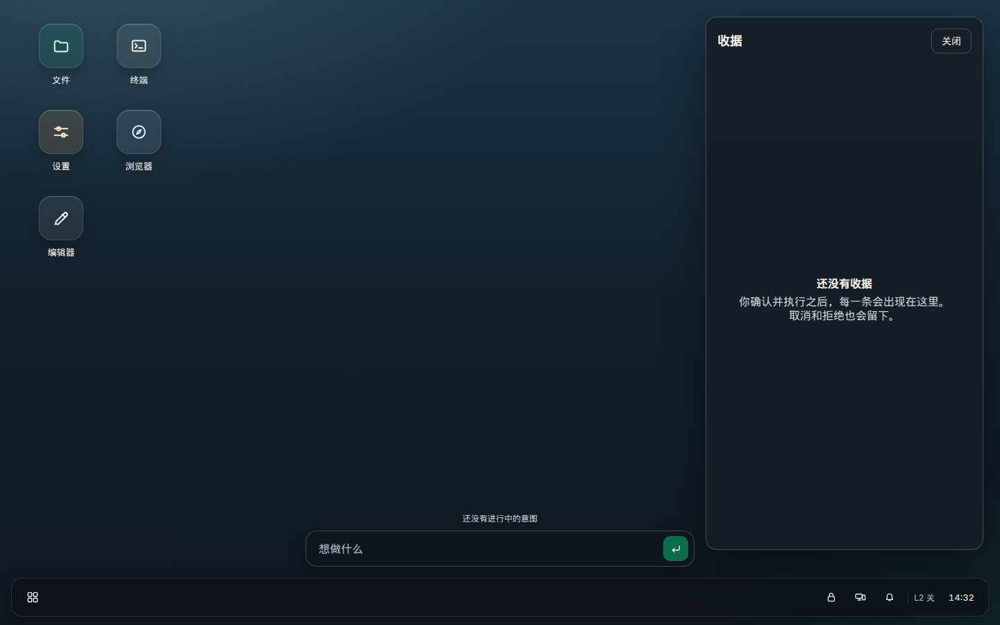

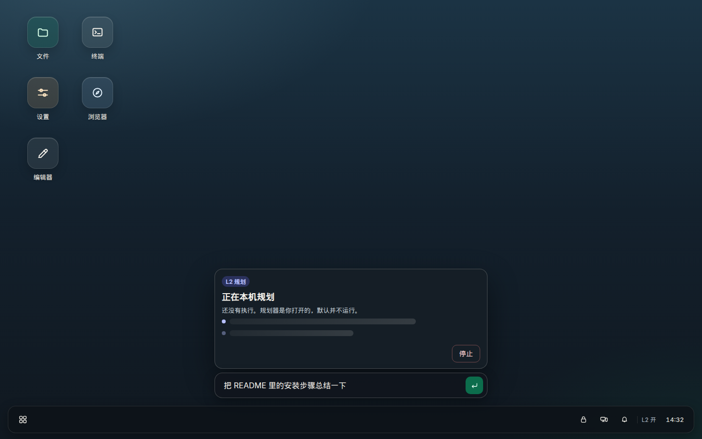

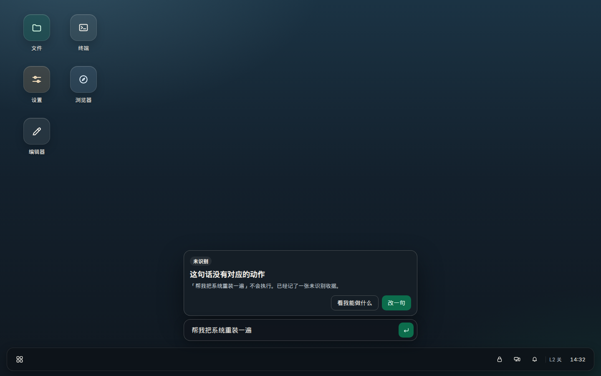

规划中只在 L2 确实打开时出现。托盘同时从「L2 关」变成「L2 开」。不要在默认桌面上放一个永远转的规划动画。

## 11. 无障碍

- 确认卡和权限单是 `dialog`，焦点圈在里面。关掉之后焦点回到意图输入。
- 规划中是 `status`，未识别是 `alert`。阶段变化用礼貌的实时区域播报：「等待确认」「已执行」「已取消」。
- 层级、决定、锁定、L2 开关都有文字，不只靠颜色或锁的形状。
- 图标按钮都有名称：提议、最小化、最大化、关闭、启动器、通知、设备、已锁定。
- 焦点环 2px 玉色，偏移 2px。不全靠背景变深。
- 粗指针目标 ≥ 48px。权限单和确认卡的主按钮在手机上高 48px。
- 中文用第 9.2 节的字体栈。不假设西文字体含汉字。
- 减少动效时，见第 9.4 节。
- 短码除了视觉数字，还要能让读屏逐位读出，避免把 `481926` 读成一个大整数。
- 对比见第 9.1 节。禁用态的弱色不用于还需要阅读的说明。
- 窗口标题和任务栏项同名，切换时播报应用名。

## 12. 给合成器的契约

壳不实现拖拽。合成器按这些尺寸做命中，避免两套标题栏。

- 标题栏高 40px。拖拽区域是标题栏里按钮以外的部分。按钮在右，顺序是最小化、最大化、关闭，各 28×28px，间距 4px。
- 最小窗口 420×280px。小于这个尺寸就不允许继续缩。
- 最大化填满任务栏上方的区域，不盖住任务栏和意图条。还原回到最大化之前的框。
- 边缘 24px 内显示落点：左半、右半或整屏。落点是一块 16px 圆角的玉色虚线区域，中间有字：「松开放到左半边」「松开放到右半边」或「松开放到整屏」。
- 活动窗口绘制在上。关闭移出栈并写一条普通的界面状态，不写收据，除非这次关闭是代理做的。代理关闭窗口仍走确认和收据。
- 会话恢复按设备保存框、栈顺序和最大化。这些几何不同步到别的设备。接续过来的是路径和草稿，不是坐标。
- 手机没有这套命中。平板用分栏，不启用自由拖拽。
- 合成器不画第二套意图条，不拦截确认和权限。

## 13. 稿面

HTML 在 `docs/ux/mockups/`，样式是 `system.css`。PNG 由无头 Chrome 按稿面尺寸截出，放在 `docs/ux/screenshots/`。

| 稿 | 尺寸 | 说明 |
| --- | --- | --- |
| `desktop-home.png` | 1440×900 | 桌面、意图条、任务栏 |
| `desktop-confirm.png` | 1440×900 | L0 确认卡 |
| `desktop-permission.png` | 1440×900 | 进程权限单，和确认分开 |
| `desktop-receipts.png` | 1440×900 | 收据抽屉 |
| `desktop-lock.png` | 1440×900 | 锁屏和身份 |
| `desktop-launcher.png` | 1440×900 | 启动器 |
| `desktop-notifications.png` | 1440×900 | 通知 |
| `desktop-windows.png` | 1440×900 | 叠放窗口和落点 |
| `state-empty.png` | 1440×900 | 空收据 |
| `state-loading.png` | 1440×900 | L2 规划中 |
| `state-error.png` | 1440×900 | 未识别 |
| `phone-home.png` | 390×844 | 手机主屏和底栏意图 |
| `phone-confirm.png` | 390×844 | 手机确认抽屉 |
| `phone-switcher.png` | 390×844 | 应用切换 |
| `phone-notifications.png` | 390×844 | 手机通知 |
| `tablet-home.png` | 1194×834 | 左栏和分栏 |
| `handoff-pair.png` | 1440×900 | 短码配对 |
| `handoff-desktop.png` | 1440×900 | 在手机上继续 |
| `handoff-phone.png` | 390×844 | 从书桌继续，以及剪贴板两份 |

重新出图：`docs/ux/mockups/render.sh`。它先跑 `build.py` 生成静态 HTML，再用无头 Chrome 按上表尺寸截图。这个脚本不参与壳的构建。
