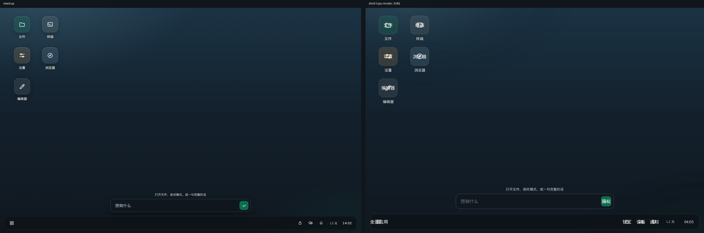
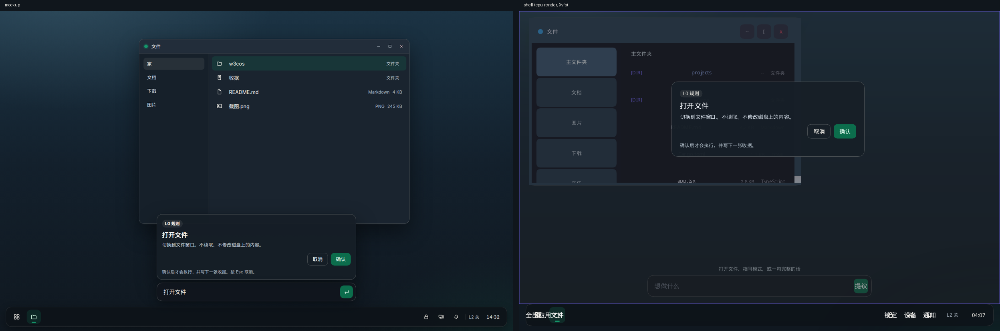
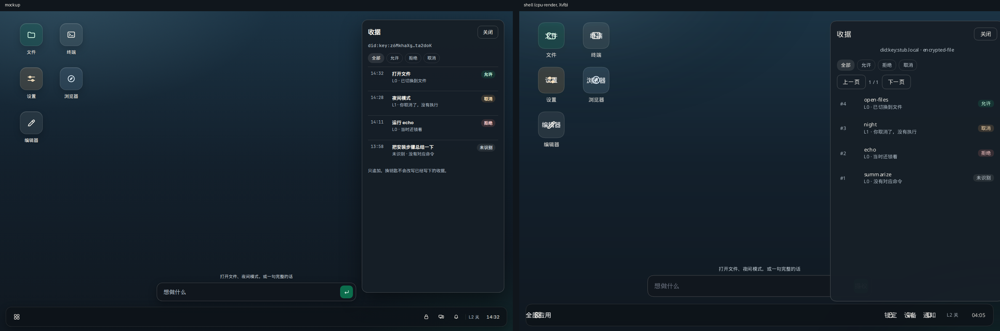
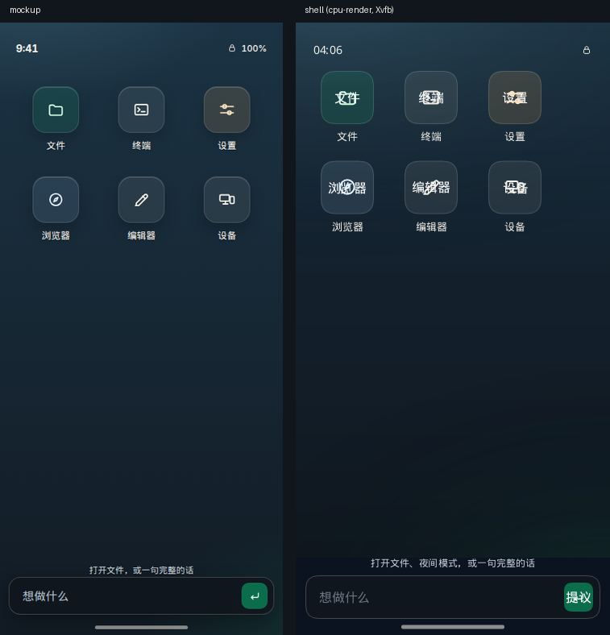

# Shell fidelity audit

Side-by-side captures compare the HTML mockups in `docs/ux/screenshots/` with the CPU renderer under Xvfb (`--no-default-features --features cpu-render`, `W3COS_LOCALE=zh-CN`). Desktop shots use `W3COS_VIEW=1200x800`. The phone shot uses `390x760`. Mockups are 1440×900 (phone 390×844) and are scaled to the same height in the pairs below. `W3COS_SCREEN=confirm|permission|receipts|lock` opens those scenes. Receipt rows in the receipts shot are seeded by that hook so the layout is visible; a real session starts empty.

| Screen | Pair |
| --- | --- |
| Desktop home |  |
| Confirm |  |
| Permission |  |
| Receipts |  |
| Lock |  |
| Phone home |  |

## Findings

| Difference | Cause | Evidence | Fix |
| --- | --- | --- | --- |
| Wallpaper was a flat `#24506e` fill. The mock is two radials plus a linear gradient. | Shell. The CPU and GPU painters already sample `background-image` gradients. | `build_desktop` / `build_phone_home` set only `background`. `background_image::tests::layered_gradient_parser_preserves_function_colors_and_normalizes_stops` and `render_cpu::font_cjk_tests::layered_wallpaper_gradient_is_not_a_flat_fill` paint a non-flat gradient. Home pixels now differ from corner `(34,59,75)` to center `(19,32,44)`. | Shell sets `WALLPAPER` on the desktop, the phone home, and the lock backdrop. |
| `radial-gradient(980px 560px at 12% -8%, …)` dropped the pixel size, and negative positions were clamped to 0. | Runtime, small. | `parse_gradient` used to ignore lengths before `at` and `parse_percent` clamped. | Parser keeps an explicit `(rx, ry)` and unclamped percentages. `explicit_radial_size_and_negative_position_are_kept`. CPU `radial_gradient_axes` uses those radii. |
| GPU radial gradients are circles. Skia’s radial shader is also a circle. | Runtime, left open. | `render_gpu.rs` and `render_skia.rs` pass `radius_x.max(radius_y)` into a circular gradient. | Plan: draw the radial gradient into a unit circle and scale the layer by `(rx, ry)` before clipping. Screenshots use the CPU path, which already honors both axes. |
| Desktop icons were solid 64px tiles, radius 12, filled white shapes. The mock is a 64px squircle, radius 18, translucent fill, 1px border, stroke icon, 13px label, 104px columns with an 8px gap. | Shell. | `icon_button` painted `app.color` and `glyph_svg` used `fill="white"`. Stroke SVGs already rasterize (`svg_path_fill_and_stroke_are_rasterized`). | `desktop_tile` / `squircle_tone` / stroke `glyph_svg`. Outer shadow `0 10px 20px rgba(0,0,0,0.18)`. |
| Squircle inset highlight (`inset 0 1px 0 rgba(255,255,255,0.16)`) plus the drop shadow. | Runtime. A style holds one `BoxShadow`, so the shell can pick only the drop. CPU used to paint `inset: true` as another outer shadow. | `Style.box_shadow` is `Option<BoxShadow>`. `draw_box_shadow` expanded the rect and ignored `inset`. Skia already skipped inset. | CPU inset now clips to the rounded box and even-odd fills the ring. `inset_shadow_stays_inside_the_box_and_outer_shadow_does_not`. GPU returns without drawing an inset (it no longer leaks outside). Plan: store up to two shadows and, on GPU/Skia, blur a rounded rect inside a clip of the padding box. |
| Dock blur (`backdrop-filter`). | Runtime, left open. | No `backdrop-filter` field on `Style`. `jsdom.rs` only lists the property name. | The dock and intent bar use the mock’s translucent rgba fills. Plan: snapshot the framebuffer under the border box, blur it, and composite before the background. |
| Intent bar was an opaque `#1e3144` slab, a white field, and a purple “提议” button at least 48px tall. The mock is a 52px translucent field, a transparent 16px input, and a 36×36 jade arrow. | Shell. Coarse pointers still use a 44–48px control. | `build_intent_panel` and `chrome_button` (`min_height: 48` on every pointer). | Fine-pointer intent matches the mock. `touch_min()` stays 48 when `pointer_is_coarse()`. |
| Dock was 64px with word buttons (“通知”, “L2 关”) and a seconds clock. The mock is 56px, 40px icons, an L2 text flag, and `HH:MM`. | Shell. The 48px pass had forced every `chrome_button`. | `build_floating_taskbar` height 64 and `%H:%M:%S`. The home capture’s dark band starts at y=732, which is `800 - 12 - 56`. | Icon tray (launcher, lock, devices, bell), jade underline on the running app, faint L2 control, `%H:%M`. Coarse pointer keeps a 64px bar and 48px icons. |
| Confirm and permission cards were flat `#1b2c3e` with filled gray/green buttons and a yellow footnote. The mock is a 440px sheet, hairline border, large shadow, ghost cancel, jade primary, coral deny, and a faint footnote. The scrim covered the dock. | Shell. | `dialog_shell`, `sheet_button`, `place_modal` (`rgba(12,18,24,160)` over the full viewport). | Sheet tokens from `system.css`. Scrim is `rgba(6,10,14,0.46)` and stops 68px above the bottom on desktop. Permission adds the capability row from `perm-cap-title` / `perm-sheet-scope`. |
| Lock was an opaque full-screen column. The mock is a centered card on the wallpaper with a coral seal. | Shell. | `build_lock_screen` used `#101820` and `place_modal(..., fill)`. Center pixel of the new capture is the card `(22,31,39)`; the corner is wallpaper `(34,59,75)`. | Full-screen wallpaper with a 420px card. No scrim. |
| Receipts were one text line per entry. The mock is a drawer with a subject line, chips, and a row of id / summary / decision pill. | Shell for layout. The ledger line has no clock and no utterance, so the time column cannot match the mock. | `receipt_log_tail` formats `#id decision command tier=… — outcome`. `parse_receipt_keeps_id_tier_and_outcome`. | Drawer is 400px, inset from the dock, with chips and pills. The left column is the operation id. Plan: append `time` and `utterance` to new receipt lines without rewriting old ones. |
| Phone home reused the desktop’s flat fill and two-column grid, with no status row or home indicator. | Shell. | `build_phone_home` called `build_desktop_icons` on `#24506e`. | Same wallpaper, three columns plus Devices, status row, bottom intent, home indicator. The hint string is still the shared `intent-hint` (the mock’s phone hint is shorter). |
| Window frames behind confirm/permission were square and unshadowed. | Shell. | `build_window_frame` had no radius or shadow. | Radius 14, hairline border, and the large shadow. Titlebar marks and the 40px titlebar are still the per-app chrome, not the mock’s shared titlebar. |
| Text weight, CJK advance, and antialiasing differ from the browser mock. | Runtime, left open. | Shell text goes through fontdue (`Inter-Regular.ttf`, `CJK-Subset.ttf`). The mock uses Inter + WenQuanYi Micro Hei in a browser. There is no `text-shadow` field. | Not a one-line paint change. Plan: keep the bundled faces, and add a text-shadow pass only if a later audit still fails on label contrast. |
| CPU shadow blur is a stack of expanding rects, not a gaussian. | Runtime, left open. | `draw_box_shadow` steps `blur_radius / 2`. | Plan: blur the shadow mask with a separable kernel when `blur_radius > 0`. Inset and outer placement are already correct. |

## What was fixed in this pass

Shell code now uses the mock tokens for the six screens: layered wallpaper, stroke squircles, the intent field, the icon dock, sheet buttons, the lock card, the receipt drawer, and the phone home chrome. Fine pointers use 36–40px controls. Coarse pointers stay at 48px.

Small runtime fixes: explicit radial sizes and negative gradient positions, and CPU inset shadows that stay inside the box. GPU inset shadows are no longer drawn as drop shadows.

## Left open

Backdrop blur, a second box-shadow, gaussian shadow blur, elliptical radials on GPU/Skia, GPU/Skia inset shadows, fontdue versus browser text, and receipt timestamps/utterances. Each row above has the next change that would close it.
